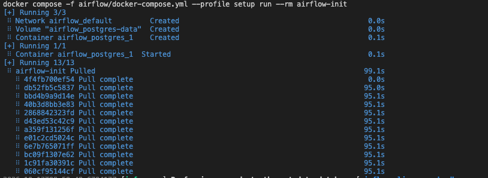
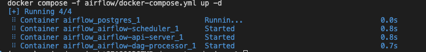
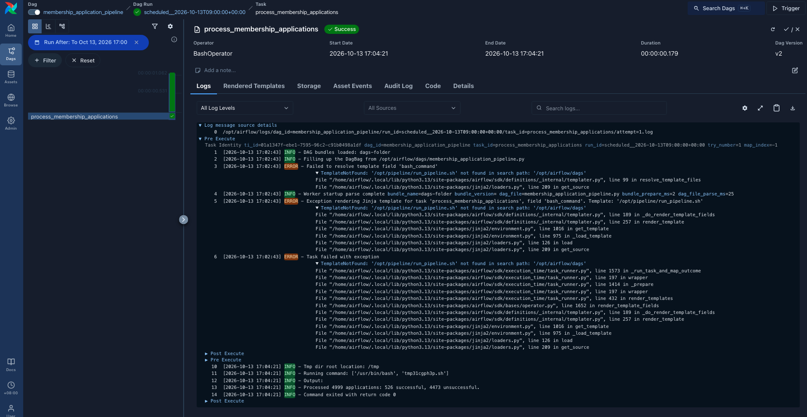

# Airflow Docker setup

This directory provides a local Apache Airflow 3.3.2 deployment that runs the Section 1 membership-application pipeline every hour. It is intended for local development and assessment demonstration, not production deployment.

## Architecture

```text
Airflow scheduler --> membership_application_pipeline DAG --> /opt/pipeline/run_pipeline.sh
                                                               |
                                                               v
                                              Section 1 input and output directories
```

The Docker Compose configuration mounts `../section-1-pipeline` at `/opt/pipeline`. The DAG therefore executes the same tested pipeline script used for local runs, and its generated CSV outputs remain in the repository's `section-1-pipeline/output/` directory. The DAG marks the script path as a literal command so Airflow does not attempt to render the `.sh` file as a DAG-folder Jinja template.

## Prerequisites

- Docker Desktop or Docker Engine with Docker Compose v2.
- At least 4 GB of memory allocated to Docker; 8 GB is recommended by Airflow for local Docker Compose use.

## Start Airflow

From this directory, initialize the Airflow metadata database once:

```bash
docker compose --profile setup run --rm airflow-init
```



Then start the API server, scheduler, and DAG processor:

```bash
docker compose up -d
```



Open <http://localhost:8080>. Authentication is disabled only in this local Docker setup and every visitor is treated as an administrator. Do not use this configuration outside a local development environment.

The `membership_application_pipeline` DAG is scheduled hourly with `catchup=False`; it will run only future hourly intervals. To run it immediately from the Airflow UI, enable the DAG and select **Trigger DAG**.

## Successful DAG run

The following Airflow task log shows the pipeline completing successfully and reporting `526 successful` and `4473 unsuccessful` applications. The same log view also preserves the earlier template-path failure, which was resolved by marking the mounted shell-script path as a literal command in the DAG.



## Airflow 3 notes

Airflow 3 replaces the former webserver with an API server and requires the DAG processor to run as a separate service. The DAG imports `BashOperator` from the Airflow standard provider, which is the Airflow 3-compatible location.

If you previously initialized this project with Airflow 2, do not reuse its metadata database volume for this major-version change. Stop the prior stack and reset the local volume before running the initialization command again:

```bash
docker compose down --volumes
```

## Verify and stop

```bash
docker compose ps
docker compose logs -f airflow-scheduler
docker compose down
```

`docker compose down` keeps the Airflow metadata volume. To remove it and reset the local Airflow instance, run `docker compose down --volumes`.

The upstream Airflow Docker Compose guidance describes this type of setup as suitable for learning and local development rather than production. [Apache Airflow Docker documentation](https://airflow.apache.org/docs/apache-airflow/stable/howto/docker-compose/index.html)
