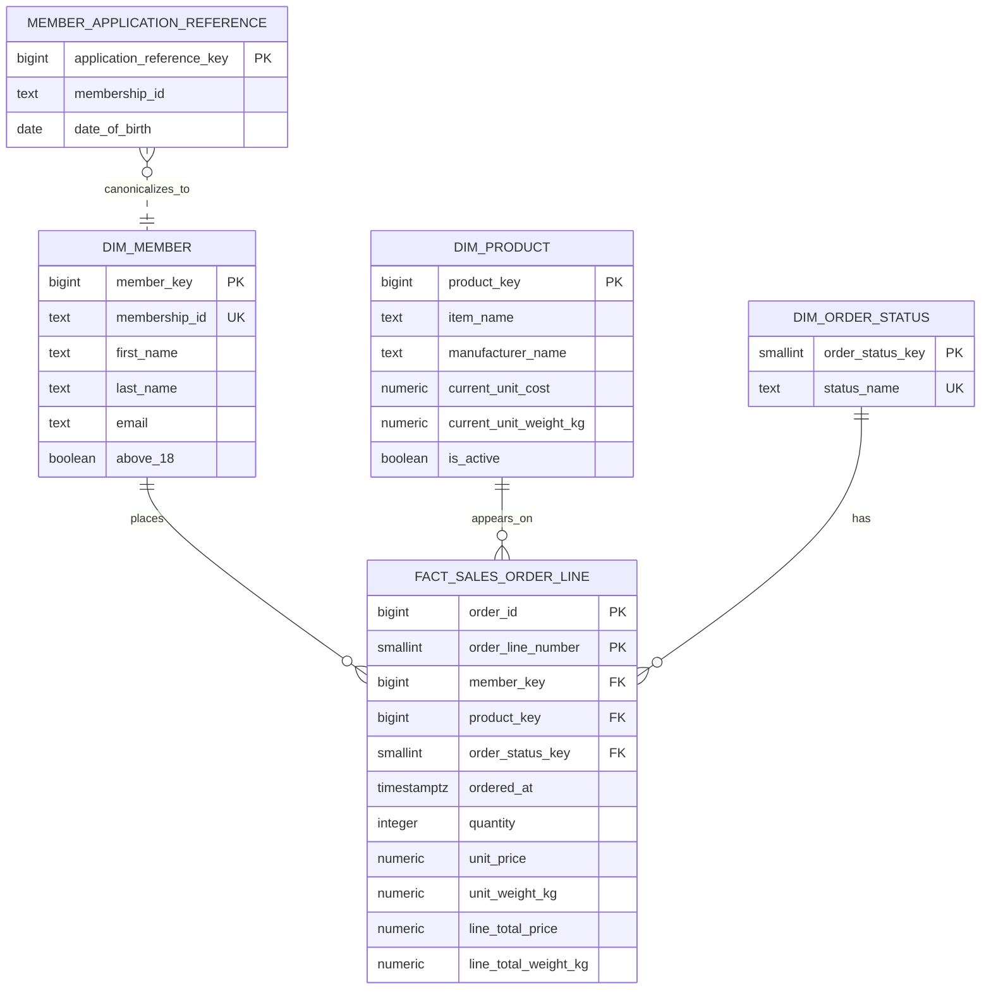

# E-commerce sales star schema

`fact_sales_order_line` has one row for each product line in an order. Its
stored price and weight measures preserve the values at the time of sale. The
product dimension stores the current catalogue attributes; it is not used to
recalculate historical order totals.

There is deliberately no `dim_date`. The stated reports do not require date
attributes, and `ordered_at` supplies the timestamp needed for filtering. A
date dimension can be added when calendar reporting becomes a requirement.
